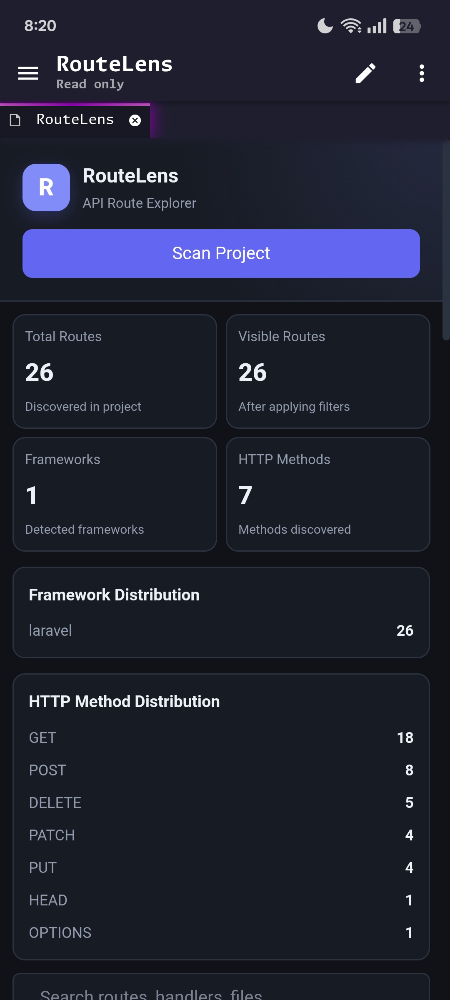
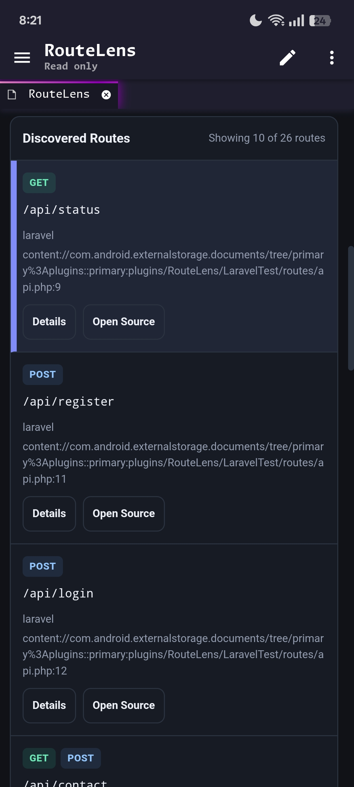
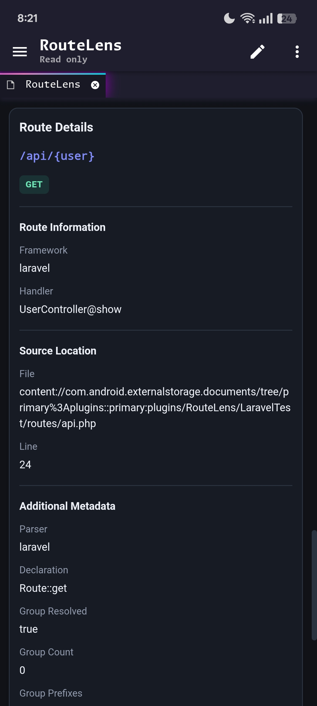
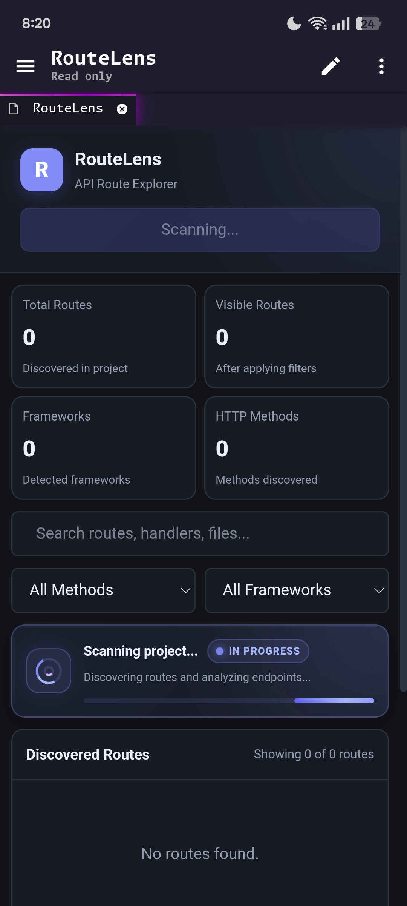
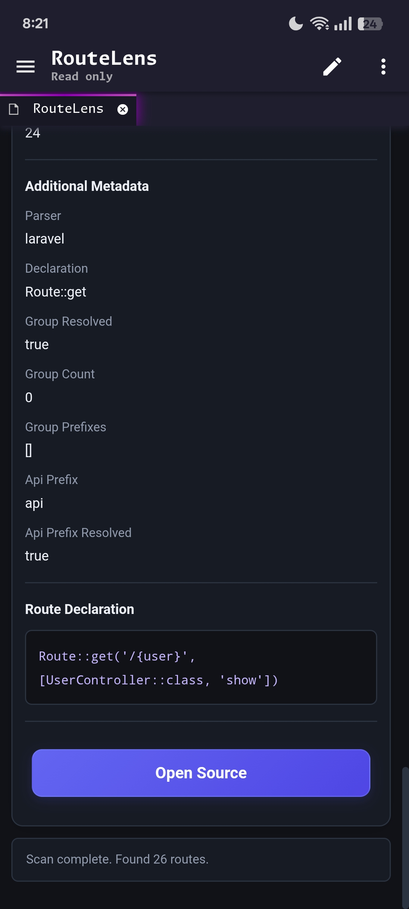

# RouteLens

**An API Route Explorer for Acode.**

RouteLens helps developers discover, analyze, navigate, and document API routes across backend projects directly from Acode.

> **Status:** Publicly available.

## Overview

Understanding API routes in a growing backend project can be difficult. Routes may be distributed across multiple files, controllers, routers, and framework-specific configurations.

RouteLens brings discovered routes together into one organized, searchable workspace. It uses static analysis to inspect project source files without starting or executing the backend application.

## Screenshots

### Interface



### Discovered Routes



### Route Details



### Workspace Scanning



### Route Declarations



## Features

### Route Discovery

- Discover API routes in supported backend projects.
- Detect HTTP methods and URL paths.
- Identify route handlers and their source locations.
- Resolve framework-specific route prefixes and nested routers where supported.
- Scan project source statically without executing the backend application.

### Supported Frameworks

| Framework | Language | Core Support |
|---|---|---|
| Flask | Python | Implemented |
| Express | JavaScript | Implemented |
| Laravel | PHP | Implemented |
| FastAPI | Python | Implemented |
| Django | Python | Implemented |
| NestJS | TypeScript | Implemented |

Framework scanners are developed and tested incrementally. Support for every framework feature or syntax variation is not implied; unsupported or complex dynamic declarations may not be resolved.

### Route Explorer

- Browse discovered routes in the RouteLens interface.
- Search and filter routes.
- Inspect route details and source locations.
- View HTTP methods and route metadata.

### Automatic Workspace Rescanning

- Monitor the selected project for file changes.
- Automatically rescan the workspace when changes are detected.
- Refresh the route list after a scan completes.
- Debounce detected changes to avoid repeatedly starting scans during bursts of file updates.

The watcher uses polling, so detection time depends on the polling interval and the file metadata available from the filesystem provider.

### Source Navigation

- Navigate from a discovered route to its source file.
- Open the source location in the Acode editor when navigation information is available.

## Roadmap

The following areas are planned for continued development:

- Additional framework-specific syntax and configuration coverage.
- More route conflict and duplicate-registration analysis.
- More detailed reporting for ambiguous or unsupported route definitions.
- Markdown and JSON route documentation exports.
- Frontend API call discovery and backend route matching.

## Architecture

RouteLens uses a modular architecture that keeps framework-specific parsing separate from the framework-independent analysis engine.

```text
RouteLens
├── Core
├── Scanners
│   ├── Flask
│   ├── Express
│   ├── Laravel
│   ├── FastAPI
│   ├── Django
│   └── NestJS
├── Analyzers
├── Navigation
├── Exporters
├── UI
├── Settings
├── Adapters
└── Utils
```

This design makes it easier to introduce additional framework scanners without coupling framework-specific parsing to the core route management system.

## Requirements

- Acode
- A compatible Android environment
- A backend project using one of the supported frameworks

## Development

Clone the repository:

```bash
git clone https://github.com/Ryze282747/RouteLens.git
cd RouteLens
```

Install dependencies:

```bash
npm install
```

Build the plugin:

```bash
npm run build
```

Run the test suite:

```bash
npm test
```

## Project Structure

```text
RouteLens/
├── src/
├── tests/
├── assets/
├── dist/
├── screenshots/
├── plugin.json
├── package.json
├── build.js
├── README.md
├── CHANGELOG.md
└── LICENSE
```

## Design Principles

- Framework-independent core architecture.
- Modular and extensible scanner system.
- Static analysis without executing backend applications.
- Dynamic project and workspace detection.
- Graceful handling of unsupported syntax.
- Automatic workspace change detection and rescanning.
- Android-friendly implementation.
- Automated tests for reliable framework support.

## Contributing

Contributions, bug reports, and feature suggestions are welcome.

Please open an issue before making significant architectural changes.

## License

RouteLens is licensed under the [MIT License](https://github.com/Ryze282747/RouteLens/blob/main/LICENSE).